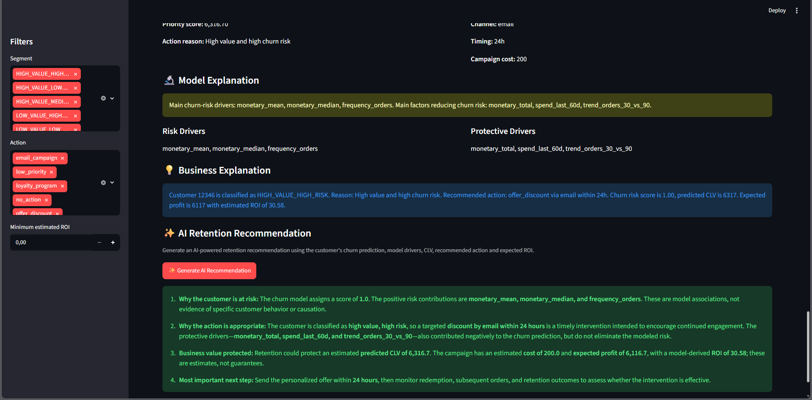
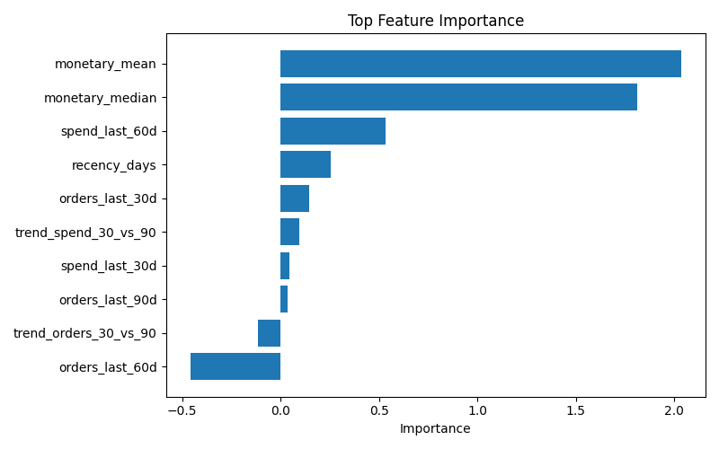
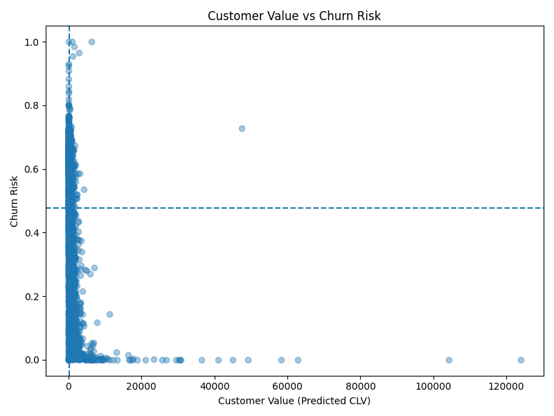

# 📊 E-commerce Churn Intelligence

**End-to-end Customer Retention Decision Engine combining churn prediction, customer lifetime value estimation, next-best-action decisioning, ROI simulation, explainable machine learning and grounded LLM recommendations.**

The project goes beyond predicting which customers may churn. It converts model outputs into customer-level retention decisions that can be explored through an interactive Streamlit application.

---

## 🚀 Project Overview

This project builds a complete customer retention decision system using transactional e-commerce data.

The system answers six practical business questions:

* Which customers are at risk of churn?
* Which customers have the highest predicted value?
* Which customers should be prioritized for retention?
* What retention action should be taken?
* Is the proposed intervention financially justified?
* How can the model recommendation be explained to a business user?

The solution combines traditional machine learning with business decisioning and an optional generative AI layer.

A leakage-safe snapshot methodology ensures that customer features are created only from information available at prediction time.

---

## 🖥️ Dashboard Preview

The interactive Streamlit dashboard provides portfolio-level monitoring and individual customer decision support.

It includes:

* executive retention summary
* portfolio churn-risk monitoring
* customer lifetime value analysis
* risk-level distribution
* global model feature importance
* customer-level risk and protective drivers
* retention opportunity ranking
* next-best-action recommendations
* campaign ROI analysis
* individual customer exploration
* model explanations
* business explanations
* on-demand AI retention recommendations



---

## ⚙️ System Architecture

```text
Raw Transaction Data
        ↓
Snapshot Creation
        ↓
Feature Engineering
        ↓
Churn Prediction
        ↓
Model Explainability
        ↓
CLV Prediction
        ↓
Priority Scoring
        ↓
Customer Segmentation
        ↓
Next Best Action
        ↓
Channel & Timing
        ↓
ROI Simulation
        ↓
Business Explanation
        ↓
Grounded LLM Context
        ↓
OpenAI API
        ↓
AI Retention Recommendation
        ↓
Streamlit Decision Engine
```

The LLM layer does not replace the predictive model. It receives structured outputs generated by the analytical pipeline and translates them into concise business-oriented recommendations.

---

## 🧠 Business Problem

Customer churn prediction alone does not answer the most important retention question:

> **What should the business do with the prediction?**

A customer can have high churn probability but relatively low economic value. Another customer may have moderate churn probability but very high predicted lifetime value.

The system therefore combines:

```text
Churn Risk
    +
Customer Value
    +
Model Explanation
    +
Retention Strategy
    +
Campaign Economics
    =
Retention Decision
```

This creates a decision-support layer on top of the predictive model.

---

## 🕒 Leakage-Safe Snapshot Methodology

A key design principle of the project is preventing target leakage.

Reference date:

```text
2011-12-09 12:50
```

Prediction snapshot:

```text
2011-09-10 12:50
```

Prediction horizon:

```text
90 days
```

Customer features are calculated using transactions available **before the snapshot date**.

Churn labels are then determined using customer activity in the future prediction window.

Dataset statistics:

```text
Transactions:          397,884
Historical records:    236,358
Customers:               3,370
Churn rate:              ~43.0%
```

This simulates a realistic situation in which the model must make a prediction without access to future customer behavior.

---

## 🧩 Feature Engineering

Customer-level features include RFM-style variables and behavioral activity windows.

Examples include:

* recency
* order frequency
* total monetary value
* average and median order value
* orders in the last 30 / 60 / 90 days
* spend in recent activity windows
* purchasing activity trends

These features create a behavioral snapshot for each customer at prediction time.

---

## 🤖 Churn Modeling

Two classification approaches are compared:

* Logistic Regression
* CatBoost

### Current validation results

| Metric    | Logistic Regression | CatBoost |
| --------- | ------------------: | -------: |
| ROC AUC   |              0.7195 |   0.7178 |
| Accuracy  |              0.6513 |   0.6409 |
| Precision |              0.5926 |   0.5789 |
| Recall    |              0.6069 |   0.6069 |
| F1        |              0.5997 |   0.5926 |

Selected model:

```text
Logistic Regression
```

Logistic Regression currently provides slightly better validation performance while also offering straightforward model interpretation.

---

## 🔬 Model Explainability

The project provides both global and customer-level model explanations.

### Global Explainability

Global feature importance identifies features with the strongest influence across the portfolio.



### Customer-Level Explainability

For every customer, the pipeline identifies:

* top churn-risk contributors
* top protective contributors
* concise model explanation

For Logistic Regression, local contributions are derived from standardized feature values and model coefficients.

This allows the dashboard to explain not only the predicted churn probability, but also which model features contributed to that prediction.

---

## 💰 Customer Lifetime Value

The system estimates customer value and combines it with churn risk.

The retention priority score is:

```text
priority_score = churn_score × predicted_clv
```

This prevents retention strategy from being driven by churn probability alone.

A high-value customer with meaningful churn risk can therefore receive higher priority than a lower-value customer with similar risk.

---

## 📊 Value vs Risk Segmentation



Customers are segmented according to predicted value and churn risk.

Examples:

* **High Value + High Risk** → immediate retention attention
* **High Value + Medium Risk** → proactive personalized intervention
* **High Value + Low Risk** → loyalty strategy
* **Low Value + High Risk** → lower-cost retention approach

The segmentation layer connects predictive analytics with business strategy.

---

## 🎯 Next Best Action

The decision engine assigns a recommended retention action according to customer segment.

| Segment                | Recommended Action |
| ---------------------- | ------------------ |
| HIGH_VALUE_HIGH_RISK   | offer_discount     |
| HIGH_VALUE_MEDIUM_RISK | personal_offer     |
| HIGH_VALUE_LOW_RISK    | loyalty_program    |
| MEDIUM_VALUE_HIGH_RISK | email_campaign     |
| LOW_VALUE_HIGH_RISK    | low_priority       |
| Other                  | no_action          |

The recommendation layer is extended with communication channel and timing.

### Example

| Segment                | Action          | Channel    | Timing |
| ---------------------- | --------------- | ---------- | ------ |
| HIGH_VALUE_HIGH_RISK   | offer_discount  | email      | 24h    |
| HIGH_VALUE_MEDIUM_RISK | personal_offer  | sales_call | 48h    |
| HIGH_VALUE_LOW_RISK    | loyalty_program | app        | 7d     |

The result is a customer-level retention plan rather than only a churn probability.

---

## 💸 Campaign ROI Simulation

The project estimates the economics of each proposed retention action.

For every customer, the system calculates:

* campaign cost
* expected retained value
* expected profit
* estimated ROI

Current simplified decision formulas:

```text
expected_retention_value = predicted_clv × churn_score

expected_profit = expected_retention_value - campaign_cost

estimated_roi = expected_profit / campaign_cost
```

Example campaign assumptions:

| Action          | Cost |
| --------------- | ---: |
| offer_discount  |  200 |
| personal_offer  |  120 |
| loyalty_program |   60 |
| email_campaign  |   20 |

These values are simulation assumptions rather than measured campaign outcomes.

The ROI layer is intended to demonstrate how model predictions can be incorporated into a business decision framework.

---

## 💡 Business Explanation Layer

Each customer receives a deterministic business explanation generated directly from pipeline outputs.

Example:

```text
Customer 12346 is classified as HIGH_VALUE_HIGH_RISK.
Reason: High value and high churn risk.
Recommended action: offer_discount via email within 24h.
Churn risk score is 1.00 and predicted CLV is 6317.
Expected profit is 6117 with estimated ROI of 30.58.
```

This layer provides a transparent explanation even when the optional LLM integration is not used.

---

## ✨ Grounded LLM Recommendation Layer

The project integrates the OpenAI API to generate concise retention recommendations for individual customers.

Before an API request is made, the pipeline creates structured customer context containing:

* customer segment
* churn score
* risk drivers
* protective drivers
* model explanation
* predicted CLV
* priority score
* recommended action
* channel
* timing
* campaign cost
* expected profit
* estimated ROI

The LLM is explicitly instructed not to:

* invent customer behavior
* infer unsupported feature direction
* infer causality from model contributions
* invent currencies
* present modeled outcomes as guaranteed results

The LLM therefore acts as a **business explanation layer on top of existing analytical outputs**, rather than as the source of the retention decision.

API requests are generated **on demand** from the Customer Explorer to avoid unnecessary API usage.

---

## 🖥️ Streamlit Decision Engine

The Streamlit application provides two levels of analysis.

### Portfolio Level

The dashboard includes:

* Executive Summary
* Portfolio Overview
* Portfolio Health
* customer risk distribution
* churn score distribution
* most frequent risk drivers
* global feature importance
* protective driver analysis
* top retention opportunities
* segment distribution
* highest-ROI customers

### Customer Level

The Customer Explorer displays:

* churn probability
* predicted CLV
* expected profit
* estimated ROI
* customer segment
* priority score
* recommended action
* channel and timing
* model explanation
* risk drivers
* protective drivers
* deterministic business explanation
* AI-generated retention recommendation

AI recommendations are generated only after the user explicitly requests them.

---

## 🗄️ SQL Data Layer

The project includes SQL-ready customer feature extraction.

Example:

```sql
SELECT
    CustomerID,
    COUNT(DISTINCT InvoiceNo) AS frequency_orders,
    SUM(Quantity * UnitPrice) AS monetary_total,
    MAX(InvoiceDate) AS last_purchase
FROM transactions
GROUP BY CustomerID;
```

The `src/database.py` module provides support for:

* SQL data loading
* database integration
* prediction export

A reference SQL feature query is available in:

```text
sql/customer_features.sql
```

---

## 📁 Project Structure

```text
ecommerce-churn-intelligence/
│
├── app/
│   └── dashboard.py
│
├── data/
│   └── raw/
│       └── Online_Retail.csv
│
├── images/
│   └── dashboard.png
│
├── sql/
│   └── customer_features.sql
│
├── src/
│   ├── config.py
│   ├── database.py
│   ├── load_data.py
│   ├── churn_label.py
│   ├── features.py
│   ├── modeling.py
│   ├── clv.py
│   ├── decisioning.py
│   ├── strategy.py
│   ├── roi.py
│   ├── explainer.py
│   ├── summary.py
│   ├── llm_context.py
│   ├── llm_service.py
│   ├── plots.py
│   └── run_pipeline.py
│
├── outputs/
│   ├── customer_features.csv
│   ├── churn_priority_table.csv
│   ├── model_explanations.csv
│   ├── feature_importance.csv
│   ├── feature_importance.png
│   ├── value_risk_matrix.png
│   └── model_metrics.json
│
├── .env.example
├── .gitignore
├── README.md
└── requirements.txt
```

---

## ▶️ Installation

Clone the repository and install dependencies:

```bash
pip install -r requirements.txt
```

For the optional AI recommendation layer, create a `.env` file in the project root:

```text
OPENAI_API_KEY=your_api_key_here
```

The `.env` file must not be committed to version control.

---

## ▶️ Running the Pipeline

Run the complete analytical pipeline:

```bash
python -m src.run_pipeline
```

The pipeline performs:

```text
Data Loading
→ Snapshot Creation
→ Feature Engineering
→ Churn Modeling
→ Model Explainability
→ CLV
→ Priority Scoring
→ Segmentation
→ Next Best Action
→ ROI Simulation
→ Business Explanation
→ LLM-ready Context
→ Output Generation
```

---

## ▶️ Running the Dashboard

Run:

```bash
python -m streamlit run app/dashboard.py
```

Then open the local Streamlit application in the browser.

The core dashboard works without making LLM requests. An OpenAI API key is required only for on-demand AI retention recommendations.

---

## 📦 Generated Outputs

The pipeline produces:

```text
outputs/customer_features.csv
outputs/churn_priority_table.csv
outputs/model_explanations.csv
outputs/feature_importance.csv
outputs/feature_importance.png
outputs/value_risk_matrix.png
outputs/model_metrics.json
```

The main decision table is:

```text
outputs/churn_priority_table.csv
```

It contains customer-level model scores, value estimates, retention decisions, explanations, ROI estimates and LLM-ready context.

---

## 💼 Business Value

The project demonstrates how machine learning outputs can be transformed into an operational decision-support workflow.

It combines:

* predictive modeling
* customer analytics
* customer lifetime value
* explainable machine learning
* segmentation
* retention prioritization
* next-best-action decisioning
* campaign economics
* business explainability
* generative AI
* interactive analytics

The objective is not simply to answer:

> **Who will churn?**

but to support the broader decision:

> **Which customer should we target, why, how, when, and what business value could the intervention protect?**

---

## ⚠️ Modeling Limitations

This project is a portfolio decision-support system built on historical transactional data.

Important limitations include:

* campaign costs are simulated assumptions
* expected profit and ROI are modeled estimates, not observed campaign outcomes
* recommended actions have not been validated through randomized retention experiments
* CLV estimates depend on historical customer behavior
* customer segmentation uses predefined business rules
* model performance may change under future data drift
* LLM recommendations depend entirely on analytical context supplied by the pipeline

In a production environment, the next step would be to validate retention strategies through controlled experiments and monitor model and business performance over time.

---

## 🔮 Future Improvements

Potential production extensions include:

* Dockerized deployment
* REST API for customer scoring
* automated model monitoring
* data-drift detection
* MLflow experiment tracking
* scheduled batch scoring
* real-time feature pipelines
* campaign response modeling
* uplift modeling
* A/B testing of retention actions
* model and LLM evaluation framework

These are treated as production extensions rather than requirements for the current portfolio version.

---

## 🔗 Related Project

Customer Lifetime Value analysis:

https://github.com/Coltrane35/customer-lifetime-value-retail

---

## 👨‍💻 Author

**Grzegorz Rączka**

---

## ⭐ Key Takeaway

```text
Simple Churn Prediction
          ↓
Customer Risk + Value
          ↓
Explainable ML
          ↓
Next Best Action
          ↓
Campaign Economics
          ↓
Grounded Generative AI
          ↓
Customer Retention Decision Engine
```

The project demonstrates an end-to-end transition from **machine learning prediction to explainable business decision support**.
